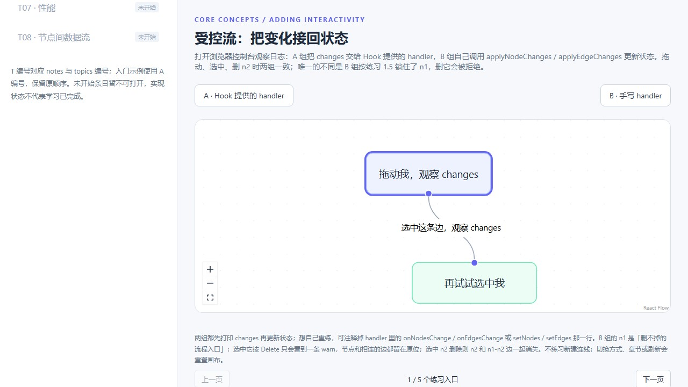

# 受控流学习笔记

源码版本：`@xyflow/react@12.12.1`。
源码地图：[SOURCE_MAP.md](../SOURCE_MAP.md)。
官方章节：[Adding Interactivity](https://reactflow.dev/learn/concepts/adding-interactivity)。
练习：[ControlledFlowExercise.tsx](../reactflow-demo/src/topics/01-controlled-flow/ControlledFlowExercise.tsx)。

## 建议阅读顺序与问题

路径以 `reactflow-study/` 为起点；先尝试练习并观察 changes，再带着问题读函数体。

| 顺序 | 源码位置 | 读的时候要回答的问题 |
| --- | --- | --- |
| 1 | `xyflow/packages/react/src/hooks/useNodesEdgesState.ts:51` · `useNodesState` | 三个返回值分别负责什么？第三个返回值如何使用最新节点状态？ |
| 2 | `xyflow/packages/react/src/utils/changes.ts:182` · `applyNodeChanges` | 输入的 changes 与 nodes 有什么区别？函数返回结果后，谁负责保存它？ |
| 3 | `xyflow/packages/react/src/utils/changes.ts:19` · `applyChanges`，接着读同文件的 `applyChange` | 为什么按 id 汇总 changes？未变化的元素与发生变化的元素，在对象引用上有何不同？ |
| 4 | `xyflow/packages/react/src/utils/changes.ts:220` · `applyEdgeChanges` | 它和 applyNodeChanges 共用了什么？选中、删除一条边时日志里的 type 是什么？ |
| 5 | `xyflow/packages/react/src/hooks/useNodesEdgesState.ts:115` · `useEdgesState` | 与 useNodesState 相比，哪些只是类型和名称变化？能否用同一条数据流解释节点和边？ |

## 核心机制

1. 受控流里，节点和边的数据由你的 React 状态保存，再传给画布。
2. 拖动、选中、删除等操作会产生 changes，它描述“哪里发生了什么变化”。
3. changes 不是完整的新节点或新边列表。
4. onNodesChange / onEdgesChange 把这份变化通知交给你的代码。
5. applyNodeChanges / applyEdgeChanges 根据变化和旧数组，算出更新后的数组。
6. 你需要把结果保存回状态，画布才能收到新的数据。
7. useNodesState / useEdgesState 提供现成 handler，封装了这一更新过程。
8. 只打印 changes 而不更新状态，受控数据就不会随操作更新。
9. changes 是“请求”不是“命令”：在写回状态之前你可以过滤、改写甚至拒绝它——练习 1.5 就是用这一点锁住 `n1`。

## 受控 vs 非受控：这个项目为什么必须受控

两套写法在库里的分界点是 store 的 `hasDefaultNodes` / `hasDefaultEdges`（由 `<ReactFlow defaultNodes>` / `defaultEdges` 决定）。同一个 `triggerNodeChanges`（`react/src/store/index.ts:265`）因此有两个分支：

| | 受控（本项目两章都是） | 非受控 |
| --- | --- | --- |
| 图数据存在哪 | 你的 React state，通过 `nodes` / `edges` prop 传进去 | 库内 store，由 `defaultNodes` / `defaultEdges` 初始化一次 |
| changes 怎么落地 | `triggerNodeChanges` 只调 `onNodesChange?.(changes)`，**没有你的写回就什么都不发生** | store 自己 `applyChanges` + `setNodes`，画布立刻更新 |
| 能不能拦 / 改 | 能。写回前想怎么改就怎么改（练习 1.5 的删除闸门、连线的 R1–R5 校验都靠这个插入点） | 拦不住、改不了。没有**写回前的插入点**：store 自己 `applyChanges` + `setNodes` 之后仍会调 `onNodesChange?.(changes)`，你只能旁听、改不了结果；能“拦”的只有 `onBeforeDelete` 这种在任何 change 产生前被 `await` 的异步闸门，它不是“事后钩子” |
| 想读当前图 | 直接读 state，天然是最新的 | 得用 `useReactFlow().getNodes()` 或旁听 `onNodesChange` |
| 代价 | 每条链路都要自己接，漏写就“画布不动”（见「遇到的问题」第 2 条）；大图要注意 `memo` 与引用稳定 | 代码少，但业务逻辑只能挂在库提供的回调上 |

这个学习项目必须受控，理由是**它要“拒绝”**：R1–R5 要在松手前决定这条边能不能进数组，练习 1.5 要在写回前扔掉某个 `remove`，后面几章还要加节点、撤销、执行引擎——每一件都需要“整份图 + 修改时机”这两样东西，只有受控状态能给。反过来，如果只是“展示一张能拖的图、不关心数据怎么变”，`defaultNodes` / `defaultEdges` 一把梭更省事。

## 我读了哪些文件

- [x] `xyflow/packages/react/src/hooks/useNodesEdgesState.ts`：`useNodesState`（第 51–66 行）、`useEdgesState`（第 115–130 行）
- [x] `xyflow/packages/react/src/utils/changes.ts`：`applyNodeChanges`（第 182–187 行）、`applyChanges`（第 19–104 行）、`applyChange`（第 107–149 行）、`applyEdgeChanges`（第 220–225 行）
- [x] 补充对照（日志从哪来、change 有哪些 type）：
  - `xyflow/packages/react/src/store/index.ts`：`triggerNodeChanges`（第 265–280 行）、`triggerEdgeChanges`（第 281–296 行）、`updateNodeInternals` 里派发 changes（第 204–209 行）、`updateNodePositions`（第 211–264 行）
  - `xyflow/packages/system/src/types/changes.ts`：`NodeChange`（第 51–57 行）、`EdgeChange`（第 81–85 行）联合类型
  - `xyflow/packages/react/src/hooks/useReactFlow.ts`：`deleteElements`（第 164–198 行）
  - `xyflow/packages/system/src/utils/graph.ts`：`getElementsToRemove`（第 483 行起）
  - `xyflow/packages/react/src/utils/changes.ts`：`elementToRemoveChange`（第 310–315 行）

## 我的理解

### 1. `useNodesState` 的三个返回值（`useNodesEdgesState.ts:51`）

- `nodes`：当前节点数组，直接传给 `<ReactFlow nodes={nodes} />`（也可以先做布局加工再传）。
- `setNodes`：就是 React `useState` 的 setter，类型 `Dispatch<SetStateAction<NodeType[]>>`，可传新数组，也可传 `(nds) => next` 形式的更新函数。
- `onNodesChange`：给 `<ReactFlow onNodesChange>` 用的现成 handler，负责把 changes 算成新数组并写回状态。

第三个返回值的实现（第 60–63 行）：

```ts
const onNodesChange = useCallback(
  (changes) => setNodes((nds) => applyNodeChanges(changes, nds)),
  []
);
```

它用的是**函数式更新**（updater）：`setNodes` 收到函数时，React 在处理更新队列时把「队列里前一步的状态」传进来，所以每条 changes 都叠在上一条结果之上，而不是读回调创建时的那份 `nodes`。因此依赖数组可以保持 `[]`，handler 引用稳定。

需要区分两种「旧值」：

- **闭包旧值**：`useCallback(..., [])` 里写 `setNodes(applyNodeChanges(changes, nodes))`，`nodes` 会被固定成回调创建那次渲染的值，之后不再更新——这才是 bug。把 `nodes` 放进依赖数组可以修好，代价是每次 `nodes` 变化都产生新 handler（下游若依赖它的引用做 memo，会多出一次更新）。
- **同一轮多个更新共用一份快照**：即使依赖正确，同一次事件里连写两次 `setNodes(applyNodeChanges(changesA, nodes))`、`setNodes(applyNodeChanges(changesB, nodes))`，两条都基于同一份 `nodes` 计算，后写的会覆盖前一条；改用更新函数则按队列依次累加，不会互相覆盖。

所以函数式更新在这个场景更省心，但**不是唯一合法写法**：把 `nodes` 写进依赖、用 `setNodes(applyNodeChanges(changes, nodes))` 同样正确。还要注意两点：更新函数拿到的是**更新队列中前一步的结果**（pending state），不保证等于最近一次已经渲染到屏幕上的状态；它也不是「提交之后」才计算，而是在渲染阶段处理更新队列时执行，`StrictMode` 开发环境下可能被调用两次，所以更新函数必须是纯函数。参考 React 官方 `useState` 文档：[基于前一个 state 更新](https://react.dev/reference/react/useState#updating-state-based-on-the-previous-state)、[初始化函数或更新函数运行两次](https://react.dev/reference/react/useState#my-initializer-or-updater-function-runs-twice)。

### 2. `applyNodeChanges`：changes 与 nodes 的区别、谁保存结果（`changes.ts:182`）

- `changes: NodeChange[]` 是**增量指令**：每条只描述“哪个元素发生了什么（`type`）”，带上该变化需要的字段（`position`、`selected`、`dimensions` 等）。它通常只涉及少数元素，甚至只涉及一个元素的一个字段。
- 注意**不是每条都有顶层 `id`**：`position` / `dimensions` / `select` / `remove` / `replace` 有 `id`；**`add` 没有 `id`**，新元素放在 `item` 里 —— `NodeAddChange = { item, type: 'add', index? }`（`packages/system/src/types/changes.ts:32-36`），ID 在 `item.id`，`index` 只是插入位置；边同理 `EdgeAddChange = { item, type: 'add', index? }`（第 61–65 行）。
- `nodes: NodeType[]` 是**完整快照**：当前全部节点。
- 一句话：changes 是“操作日志”，nodes 是“当前状态”，changes 不能直接当 nodes 用。
- 函数体只有第 186 行 `return applyChanges(changes, nodes) as NodeType[]`，只做类型包装，**不接触 React state**，也不修改输入数组。
- 返回值是**新数组**，谁调用谁保存：
  - 用 hook：hook 内部的 `setNodes` 保存（`useNodesEdgesState.ts:61`）。
  - 手写：`setNodes((oldNodes) => applyNodeChanges(changes, oldNodes))`。
  - 不保存 = 画布下一次渲染还是旧数据，只剩控制台日志。

### 3. `applyChanges` + `applyChange`：为什么按 id 汇总、引用有何不同（`changes.ts:19`、`107`）

`applyChanges` 分两段：

1. 第一段（第 28–51 行）把 changes 按 `id` 收进 `changesMap: Map<id, change[]>`；`add` 单独放进 `addItemChanges`；遇到 `remove` / `replace` 时直接 `changesMap.set(id, [change])` **覆盖**已排队的变化——元素都要被删 / 换了，同 id 的其他变化没有意义。
2. 第二段（第 53–87 行）遍历 `elements`，用 `changesMap.get(element.id)` O(1) 查。

`add` 之所以单独收集：它没有顶层 `id`（ID 在 `item.id` 里，见 `NodeAddChange`），没法按 `change.id` 汇总；而且带 `index` 时要等其它元素排好后才能确定插入位置。

为什么按 id 汇总：

- 避免对每个元素都去 `changes` 里线性查找（否则是 O(elements × changes)），现在是一次哈希查找。
- 同一元素的多条变化（一次拖动里的连续 `position`，或 `position` + `dragging`、`select` + `position`）能合并到**同一份拷贝**上依次应用，只产生一个新对象。

对象引用上的差别（React 侧性能的关键）：

| 情况 | 处理 | 引用结果 |
| --- | --- | --- |
| 元素没有变化 | 第 61 行 `updatedElements.push(element)` | **同一个对象引用**，`next[i] === prev[i]`，`memo` / 引用比较可直接跳过重渲染 |
| 元素有 `select` / `position` / `dimensions` 变化 | 第 80 行 `const updatedElement = { ...element }`，再让 `applyChange` 在这份拷贝上**就地修改**（第 106 行注释写明是 mutable update） | 新的顶层对象；`data`、`style` 等嵌套对象仍是浅拷贝后的共享引用 |
| `replace` | 第 71 行 `push({ ...changes[0].item })` | 以 change 携带的新元素为准，做一次浅拷贝 |
| `remove` | 第 66–68 行 `continue` | 不再 push，等于从数组中移除 |

`add` 放到最后处理（第 93–101 行）：带 `index` 的插入要等旧元素都排好后 `splice(index, 0, { ...item })` 才能落在正确位置，没有 `index` 就 push 到末尾。

`applyChange`（第 107–149 行）只处理三种 type：`select` → 写 `selected`；`position` → 写 `position` / `dragging`；`dimensions` → 写 `measured`（`setAttributes` 时同时写 `width` / `height`）和 `resizing`。`add` / `remove` / `replace` 不在这里，因为在 `applyChanges` 里已经处理完；switch 没有 `default`，无法识别的 type 被静默忽略，不抛错。细节：`element.position = change.position`（第 116 行）直接把 change 里的对象赋过去，不再克隆。

### 4. `applyEdgeChanges`：与 `applyNodeChanges` 的关系、边的日志 type（`changes.ts:220`）

- 共用**同一个** `applyChanges`，只是类型不同：第 224 行 `return applyChanges(changes, edges) as EdgeType[]`。所以“按 id 汇总、未变化元素保留引用、变化元素浅拷贝、`remove` 过滤、`add` 按 index 插入”对边完全一样。
- `EdgeChange` = `EdgeSelectionChange | EdgeRemoveChange | EdgeAddChange | EdgeReplaceChange`（`packages/system/src/types/changes.ts:81`），**没有 `position` / `dimensions`**：边的位置由两端节点算出来，不是独立状态。类型上 `EdgeSelectionChange = NodeSelectionChange`、`EdgeRemoveChange = NodeRemoveChange`（第 59–60 行），所以 `applyChange` 里处理 `select` 的分支对边也够用。
- 日志里的 type：
  - 点击 / 框选一条边 → `{ id: 'n1-n2', type: 'select', selected: true }`；点空白取消 → `type: 'select', selected: false`。
  - 选中边后按 `Delete` / `Backspace` → `{ id: 'n1-n2', type: 'remove' }`（`deleteElements` 用 `elementToRemoveChange` 生成，`useReactFlow.ts:187` → `changes.ts:310`）。
  - 附带：删除一个节点时，除了节点的 `remove`，与它**相连的边**也会各产生一条 `remove`（`getElementsToRemove` 里用 `getConnectedEdges` 把相连边一起纳入，`graph.ts:517`）。
- 日志的真正来源是 store：`triggerNodeChanges`（第 265 行）/ `triggerEdgeChanges`（第 281 行）。受控模式下 `hasDefaultNodes` / `hasDefaultEdges` 为 false，它们**只**调用 `onNodesChange?.(changes)` / `onEdgesChange?.(changes)`；非受控模式才会自己 `applyChanges` + `setNodes`。这是受控 / 非受控的分界点。

### 5. `useEdgesState`：与 `useNodesState` 的差别（`useNodesEdgesState.ts:115`）

- 只有名字和类型变了：`EdgeType extends Edge = Edge`、`OnEdgesChange`、`applyEdgeChanges`、`setEdges`。
- 结构逐行对应：第 123 行 `useState(initialEdges)`，第 124–127 行 `useCallback((changes) => setEdges((eds) => applyEdgeChanges(changes, eds)), [])`，对应第 59 行和第 60–63 行；JSDoc 也是同一份，只把 nodes 换成 edges。
- 可以用同一条数据流解释节点和边：

```
你的 React 状态 (nodes / edges)
  → <ReactFlow nodes={nodes} edges={edges}>
  → 用户操作（拖动 / 点击选中 / Delete）
  → store 生成 changes（只描述变化）
  → onNodesChange / onEdgesChange(changes)
  → applyNodeChanges / applyEdgeChanges(changes, 旧数组) → 新数组
  → setNodes / setEdges 保存
  → 新 props → 画布重渲染
```

节点和边的差别只有两处：`changes` 里能出现的 type（节点多 `position` / `dimensions`），以及 `ReactFlow` 用哪个 prop 接收。所以受控状态这条链路对节点和边是**同一个机制**。

## 练习 1.5：让 `n1` 删不掉（changes 层的“拒绝”）

需求：`n1` 是流程入口，不允许被删除。要求加在 B 组（手写 handler）里，因为“能拒绝 changes”正是受控流真正有价值的地方。

### 实现

```ts
// 只有 n1 的 remove 被丢掉；位置、选中、尺寸变化照旧应用
const acceptedChanges = changes.filter(
  (change) => !(change.type === 'remove' && change.id === LOCKED_NODE_ID),
)
setNodes((currentNodes) => applyNodeChanges(acceptedChanges, currentNodes))

// 边的 remove 不带端点信息，只在当前边里查得到它是否连着锁定节点
setEdges((currentEdges) => {
  const acceptedChanges = changes.filter(
    (change) =>
      change.type !== 'remove' ||
      !currentEdges.some(
        (edge) =>
          edge.id === change.id &&
          (edge.source === LOCKED_NODE_ID || edge.target === LOCKED_NODE_ID),
      ),
  )
  return applyEdgeChanges(acceptedChanges, currentEdges)
})
// 边先到、节点后到：只有节点批次才知道这次真正删掉谁，在这里清掉两端已不存在的边
const removedNodeIds = acceptedChanges.flatMap((change) =>
  change.type === 'remove' ? [change.id] : [],
)
if (removedNodeIds.length > 0) {
  setEdges((currentEdges) =>
    currentEdges.filter(
      (edge) => !removedNodeIds.includes(edge.source) && !removedNodeIds.includes(edge.target),
    ),
  )
}

```

三段代码分别对应三个坑：

1. **`remove` 只带 `id`**，判断“这条边连着锁定节点”必须回到当前边数组里查端点；把查询放进 `setEdges` 的更新函数里，就不必把 `edges` 写进依赖数组。
2. **节点和边是两批独立 change**，而且**边那一批先到**：`deleteElements` 先 `triggerEdgeChanges`（`useReactFlow.ts:186-191`）再 `triggerNodeChanges`（第 193-198 行）。所以处理边的回调里拿不到“这次删掉哪些节点”。
3. 因为拿不到，只能在**后到的节点批次里收尾**：把这次真正被接受的 `remove` 节点 id 收集起来，再清掉两端已不在图里的边，否则删 `n2` 时会留下一条指向已删节点的悬空边（`n1-n2` 的边 remove 已被第 1 条规则挡掉了）。

### 实测结果（真实浏览器，同一套 CDP 脚本）

| 操作 | 日志 | 状态结果 |
| --- | --- | --- |
| B 组选中 `n1` 按 Delete | `onEdgesChange: remove:n1-n2` → `onNodesChange: remove:n1` → `warn 拒绝删除 n1` | 节点仍是 `n1`、`n2`，边仍是 `n1-n2`；画布毫无变化 |
| B 组选中 `n2` 按 Delete | 同样是边先、节点后两批 | `nodes = [n1]`、`edges = []`、DOM 剩 1 个节点 0 条边，**没有悬空边**（节点批次的收尾生效） |
| B 组拖动 `n1` | 11 批 `onNodesChange`，**没有任何 `remove`** | 位置照常跟随，锁定不影响其它 change |
| B 组单独选中边再 Delete | `onEdgesChange: remove:n1-n2` | 边**留在原地**（`selected` 仍为 true）——见下面的代价 |
| A 组（对照）选中 `n1` 按 Delete | `remove:n1-n2` → `remove:n1` | `nodes = [n2]`、`edges = []`，节点和边一起删掉 |

### 代价与更合适的写法

- **代价**：这套规则只看得见自己这一批 change，所以“与 `n1` 相连的边”也变得不能单独删除了——`n1` 和它的连线被一起锁住。这在业务上说得通（入口节点不该被摘掉连线），但如果要求“节点留着、边随便删”，就必须知道这次删除是冲着谁来的。
- **库给的开关一：`onBeforeDelete`**（`graph.ts:483-545`，类型在 `packages/system/src/types/general.ts:380-386`）。它挂在 `getElementsToRemove` 的末尾：库先把“候选节点 + 相连边”算好（此时 `deletable: false` 的元素已经被剔掉），再把这一整批交给你，并 `await` 你的返回值。所以**它是异步钩子**：`({ nodes, edges }) => Promise<boolean | { nodes: NodeType[]; edges: EdgeType[] }>`。返回 `true` = 全放行；返回 `false` = **节点和边一起清空，一个都不删**（`graph.ts:540-542`，不是“只拦节点、边照删”）；想只放行一部分必须返回 `{ nodes, edges }` 子集，而且必须是元素对象本身，不能只给 id。判断一次就够，也不会产生任何被拒绝的 change：

  ```tsx
  // 类型要求返回 Promise，写成 async 最简单（也可以手写 Promise.resolve(...)）
  <ReactFlow
    onBeforeDelete={async ({ nodes, edges }) => ({
      nodes: nodes.filter((node) => node.id !== LOCKED_NODE_ID),
      edges: edges.filter(
        (edge) => edge.source !== LOCKED_NODE_ID && edge.target !== LOCKED_NODE_ID,
      ),
    })}
  />
  ```

  为什么说它是“删除闸门”：Delete 键走 `useGlobalKeyHandler.ts:31-37`（把选中的节点 / 边交给 `deleteElements`），而你自己调 `deleteElements()` 用的是同一个函数（`useReactFlow.ts:164-204`），两条路径都会经过 `getElementsToRemove`，所以**都拦得住**，不存在“只对键盘删除生效”的问题。它真正拦不住的是绕过 `deleteElements`、直接改状态（比如自己 `setNodes(nodes.filter(...))`），那本来就不经过库。另外它被 `await`，所以可以在这里弹确认框再决定删不删。我这版仍然写在 changes 层，是为了把“拒绝请求”这件事看见、摸到。

- **库给的开关二：`deletable`**。`getElementsToRemove` 先跳过 `node.deletable === false` 的节点（`graph.ts:503`），再**只从“可删节点”出发**收集相连边（第 517 行），并且只考虑 `edge.deletable !== false` 的边（第 516 行）。所以在节点上写 `deletable: false` 的准确含义是「这个节点删不掉」，**不等于“它的连线也删不掉”**：单独选中一条边时走的是第 520-526 行，只要这条边自身没有 `deletable: false`、又被明确列进 `edgesToRemove`，它照样会被删。

  这一点我临时给 `n1` 加上 `deletable: false` 实测过（跑完已还原），A 组（没有 changes 层过滤）和 B 组（练习 1.5）对照：

  | 场景 | A 组（只有 `deletable`） | B 组（`deletable` + 练习 1.5） |
  | --- | --- | --- |
  | 选中 `n1` 按 Delete | 什么都不删；`onNodesChange` **只收到 1 批 `select`**——连 `remove` 都没派发，库内就已经把它剔掉了 | 同上（练习 1.5 的过滤根本没被触发） |
  | 选中边 `n1-n2` 按 Delete | **边被删掉**（`nodes = [n1, n2]`、`edges = []`），说明节点上的标记不保护连线 | 边留下——拦住它的是练习 1.5 的 changes 过滤，不是 `deletable` |
  | 选中 `n2` 按 Delete | `nodes = [n1]`、`edges = []`，相连边跟着删 | 同左 |

  结论：`deletable` 是“声明式标记”，把判断前移到库内、一行代码都不用写，代价是**粒度只到元素本身**；要“入口节点和它的连线一起锁住”，仍然得靠 `onBeforeDelete` 返回子集（一次看到整批）或在 changes 层写规则（能读实时状态：选中项、权限、当前模式）。

- 两条前置事实：Delete 键本身只是把**选中的元素**交给 `deleteElements`（`useGlobalKeyHandler.ts:31-37`），所以“拒绝”必须发生在数据写回之前，而不是在键盘事件里拦。

- **拦 changes 的覆盖面与盲区（源码核实）**：`deleteElements`（`useReactFlow.ts:164-204`）的执行顺序是 `onEdgesDelete` → `triggerEdgeChanges` → `onNodesDelete` → `triggerNodeChanges` → `onDelete`。键盘 Delete（`useGlobalKeyHandler.ts:26/34`）和手动 `deleteElements()` 最后都汇到 `triggerEdgeChanges` / `triggerNodeChanges`，所以在 changes 层过滤**能拦住所有删除入口**——被拒绝的 `remove` 不写回状态，图就不变。但删除类回调并不知道删除被拒绝了：`onNodesDelete` / `onEdgesDelete` 在 `triggerNodeChanges` / `triggerEdgeChanges` **之前**被调用、`onDelete` 在**之后**被调用，它们拿到的 `matchingNodes` / `matchingEdges` 是 `getElementsToRemove` 算好的候选，不经过你的 changes 过滤，所以即便你在 changes 层拒了，这几个回调也照样触发。要“整批看到再决定”且“拒绝后回调也不误报”，用 `onBeforeDelete`：它在 `getElementsToRemove` 里被 `await`（`graph.ts:528-545`），位于所有删除回调之前，返回子集后 `onNodesDelete` / `onDelete` 拿到的就是过滤后的结果。

## 实测记录：预测 vs 实际

实测环境：`pnpm dev` 起本地页面（React 19 + `StrictMode`，`@xyflow/react@12.12.1`），用 Chrome DevTools Protocol 驱动**真实鼠标事件**（move → press → 10 次 move → release）和 Delete 键；`console.log` 的参数在页面脚本执行前就被钩住并序列化，节点位置取 `.react-flow__node` 的 `style.transform`，选中态取 `class` 里有没有 `selected`。每次流程一致：进 04 章 → 切到 B 组 → 再操作。（驱动脚本只放在本地临时目录，不进项目。）

| 操作 | 我的预测 | 实际结果 |
| --- | --- | --- |
| 首次加载，什么都不操作 | 会有 `dimensions`，但不清楚几条、几批 | 每挂载一次画布 **1 批**，批内 **2 条** `dimensions`（`n1` 150×50、`n2` 150×50）。进 04 章（默认 A 组）1 批，切到 B 组再 1 批；**没看到** StrictMode 造成的重复 `dimensions` |
| 拖动 `n1`（鼠标 +70/+45，分 10 次移动） | 一串 `position`，最后一条 `dragging: false` | **共 11 批**：第 1 批是 `select n1 selected=true`（拖动一个未选中的节点会顺带选中它），接着 **9 批** `position … dragging=true`，松手后 **1 批** `position … dragging=false`。每条 change 单独成批，没有被合并成一批 |
| 单击 `n2`（不移动） | 应该有 `select` 变化 | **1 批 2 条**：`select n1 selected=false` + `select n2 selected=true`——旧的取消选中和新的选中在同一批里 |
| 单击空白画布 | 取消选中的 `select false` | **1 批 1 条**：`select n2 selected=false`，没有其它噪声 |
| 单击边 `n1-n2` | `onEdgesChange` 收到 `select` | **1 批 1 条**：`select n1-n2 selected=true` |
| 选中边后按 Delete | `remove` | **1 批 1 条**：`remove n1-n2`；边从 DOM 消失，两个节点不动、节点状态不产生 change |
| 注释掉 B 组 `setNodes(...)` 后再拖动 `n1` | 节点应该完全不动，但日志照旧 | 与预测一致：日志仍是 11 批（内容和上面逐条相同，含 `select: true`），但 `n1` 全程停在 `translate(0px, 0px)`、`.selected` 样式不出现 |
| B 组选中 `n1` 按 Delete（练习 1.5） | 会被拒绝，节点和边都不动 | **两批，边先到**：`onEdgesChange: remove:n1-n2` → `onNodesChange: remove:n1` → 一条 warn；状态里仍是 2 个节点、1 条边，DOM 完全没有变化 |
| B 组选中 `n2` 按 Delete（练习 1.5） | 正常删除 | `remove:n1-n2` → `remove:n2` 两批；状态变成 `nodes=[n1]`、`edges=[]`，节点批次里的收尾把被拦下的那条边清掉了 |
| B 组单独选中边后按 Delete（练习 1.5） | 边应该能删掉 | **删不掉**：`remove:n1-n2` 被规则拦下，边仍是 `selected: true`。这是“只看得见自己这一批 change”的代价 |

三个和预测不完全一样、值得单独记住的细节：

- **坐标换算除以 zoom（源码事实），旧实验的精确 zoom 未知**：`getPointerPosition`（`system/src/utils/dom.ts:11-28`）调用 `pointToRendererPoint`（`utils/general.ts:168-180`），使用 `(x - tx) / tScale`。`XYDrag.ts` 的 rAF 用于自动平移，不是拖动位置更新的节流，因此原来的“rAF 丢弃末段位移”解释错误。但也不能直接断言旧日志 `(37.1,23.5)` 等于 `(70/zoom,45/zoom)`：默认 `nodeDragThreshold: 1`（`react/src/store/initialState.ts:114`）下，`XYDrag.ts` 会在越过阈值的移动事件里调用 `startDrag`，用当时指针位置建立拖动偏移。无平移、无吸附时，应使用**实际拖动起点到终点的屏幕位移 ÷ zoom**，未必是按下到松手的总位移。
- **旧 zoom 范围仅为推断，撤回“两个轴交叉验证”的表述**：旧记录未保存 viewport transform 或拖动起点。`70/37.1≈1.89` 与 `45/23.5≈1.91` 是用总位移反推的两个不同数，不足以确认实际 zoom；练习 1.6 的比值同理。“约 1.7–1.9、与 fitView 相符”只是假设，不能升级为实测。下面用本次直接读取的 zoom 做独立对照，不追认旧数据。

- **不写回状态时，点空白一条 change 都不会有**：因为 props 里的节点从来没被标记成 `selected`，store 认为没有“可取消的选中项”，连 `select: false` 都不派发。这说明选中态**确实只存在于你的状态里**，不是画布自己的内部状态。
- **删除时边比节点先到**：`deleteElements` 先 `triggerEdgeChanges`（`useReactFlow.ts:186-191`）再 `triggerNodeChanges`（第 193-198 行）。所以“这条边要不要跟着节点一起删”没法在边那一批里靠节点批次的结论决定——练习 1.5 因此要在后到的节点批次里再收尾一次（清掉两端已不存在的边）。


### 补测：读取 zoom，并隔离拖动阈值（2026-11-06）

环境：当前提交 `e09bbe6` 上的 demo，React Flow 12.12.1，浏览器内容视口 1280×720，T01 B 组，每轮重新挂载使 n1 从 `(0,0)` 起始。拖动命令均为屏幕 `(700,490) → (770,535)`。预测：坐标差应除以**直接读取**的 zoom；默认阈值下有效起点可能晚于按下，零阈值下应为完整的 `70/zoom`、`45/zoom`。临时添加 `onNodeDragStart` / `onNodeDragStop` 的 JSON 日志，结束后全部恢复。

拖前和拖后 `.react-flow__viewport` 都是 `translate(240.452px, 16px) scale(1.55238)`，计算样式为 `matrix(1.55238, 0, 0, 1.55238, 240.452, 16)`；未发生自动平移或缩放。CSS 序列化保留有限小数，以下比对允许约 0.0001 画布单位的误差。

| 配置 | 实测 start / stop 的 client 坐标 | 按读取的 zoom 计算 | stop 日志中的 node.position / DOM |
| --- | --- | --- | --- |
| 原始默认阈值 1 | `(709,496)` → `(770,535)` | `61/1.55238≈39.2945`；`39/1.55238≈25.1227` | `(39.29447852760737,25.12269938650307)`；`translate(39.2945px,25.1227px)` |
| 临时 `nodeDragThreshold={0}` 对照 | `(700,490)` → `(770,535)` | `70/1.55238≈45.0920`；`45/1.55238≈28.9877` | `(45.0920245398773,28.987730061349694)`；`translate(45.092px,28.9877px)` |

两轮结果分别吻合预测。**实测验证的是坐标换算及阈值起点差异，未复现旧记录 `70/zoom≈37.1`**。旧实验缺少当时的 viewport 与实际 drag start，不能从现在的窗口恢复历史 zoom，也不能把残差归咎于 rAF。不要人为调 zoom 直到凑出旧数值。临时回调和零阈值配置均已恢复，demo 的默认拖动行为未改变。

原截图删除后于 2026-11-06 补拍：仅在测试浏览器加载模块时临时设 `nodeDragThreshold: 0`，未修改项目源码。B 组从 `(0,0)` 起，鼠标移动 `(+70,+45)`；读取 zoom 为 `1.55238`，节点最终为 `translate(45.092px,28.9877px)`，与零阈值对照结果一致。补拍视口平移为 `(247.952,16)`，不冒充上一轮的原始截图。



## 遇到的问题

1. **什么都没操作也有日志**：首帧测量节点尺寸会派发 `dimensions`（`store/index.ts:204-209` 的 `updateNodeInternals`）。实测：每挂载一次画布 1 批 2 条（`n1`、`n2` 各 150×50），`fitView` 那一轮没有额外带出 changes；`main.tsx` 开着 `StrictMode`，注入类 effect 会跑两次，但尺寸没变时 `updateNodeInternals` 不会再派发，所以这次**没看到**重复日志。真看到重复时也知道不是“我操作错了”。
2. **只打印不更新 = 日志有、画布不认（实测纠正）**：受控模式下画布的位置和选中态都来自 props 里的 `nodes`。把 B 组的 `setNodes((currentNodes) => applyNodeChanges(changes, currentNodes))` 注释掉再拖 `n1`，节点**从按下到松手一直停在 `translate(0px, 0px)`**，`.selected` 样式也不出现；`onNodesChange` 照样打印 11 批日志，store 内部确实派发了 `select n1 selected=true`，但没人写回状态，视觉上就什么都没发生。所以不是“拖的时候动了、松手才弹回旧位置”——它根本没动过。同理，`deleteKeyCode` 删除节点也只是把 `remove` 交给你的 handler，不写回就不会被删掉。源码上的原因：`system/src/xydrag/XYDrag.ts:214` 拖动过程中只调 `store.updateNodePositions`，而 `react/src/store/index.ts:211` 的 `updateNodePositions` 只做“拼 changes + `triggerNodeChanges(changes)`”，并不改 `nodeLookup`；受控模式（`hasDefaultNodes === false`）下 `triggerNodeChanges` 也只调 `onNodesChange?.(changes)`（第 265–280 行）。整条链路上没有一处替你写状态。
3. **依赖漏写会捕获闭包旧值，同一轮多个更新会共用快照**：`useCallback(..., [])` 里写 `setNodes(applyNodeChanges(changes, nodes))`，`nodes` 被锁在回调创建那次渲染；把 `nodes` 写进依赖也能修好，但每次节点变化都会换一个新 handler。函数式更新 `setNodes((nds) => applyNodeChanges(changes, nds))` 更省心，但要记住它读的是更新队列里的前一步结果，不保证等于屏幕上已渲染的那一版，也不在提交后计算。
4. **依赖数组怎么填**：用函数式更新时，`setNodes` 是稳定的、`applyNodeChanges` 是模块级函数，依赖写 `[]` 就够（hook 源码第 62 行就是 `[]`）。手写 handler 若引用外部变量，才需要把它们列进去。
5. **不要原地改输入**：`applyNodeChanges` 返回新数组（未变化的元素沿用旧引用、变化的元素是浅拷贝）。直接改 `node.position` 再 `setNodes(原数组)` 不会生效：`setNodes` 收到和当前 state 同一个引用（`Object.is` 相等）时会**直接跳过这次更新**，子组件不重渲染、effect 也不重跑，界面上看不到任何变化。（React 文档的补充：这次更新仍可能先调用一次该组件的渲染函数再丢弃结果，但不会提交，所以依然看不到变化。）
6. **浅拷贝的坑**：`updatedElement` 只有顶层是新对象，`data` 仍与旧节点共享。想改 `data.label` 必须自己再造一层，不能指望 `applyNodeChanges` 深拷贝。
7. **`remove` 会“吞掉”同 id 的其它变化**：`changesMap.set(id, [change])` 覆盖，所以同一批里先 `position` 后 `remove`，只剩删除；`add` 被推迟到最后执行，带 `index` 时用 `splice` 插到指定位置。
8. **只接节点不接边**：只写 `onNodesChange` 时，边的选中 / 删除同样不会更新，必须另外接 `onEdgesChange` + `applyEdgeChanges`；反过来只接边也修不好节点，两者是各自独立的状态。
9. **练习里连不出新线**：`nodesConnectable={false}` 且没有 `onConnect`，这是刻意边界，不是 bug；本章只练“变化如何写回状态”。
10. **切换 A / B 画布被重置**：`ControlledFlowExercise` 用 `mode` 条件渲染两个组件，切换时旧组件卸载、新组件用 `initialNodes` / `initialEdges` 重新挂载，所以拖动结果消失。这是对照用的设计重置，不是状态 bug。
11. **删除是“节点 + 相连边”的两批 change，且边先到**：`getElementsToRemove` 会把相连的边一起纳入候选（`graph.ts:517` 的 `getConnectedEdges`），`deleteElements` 随后先派发边的 `remove`、再派发节点的 `remove`（`useReactFlow.ts:186-198`）。所以在 `onEdgesChange` 里无法知道“这次是不是在删某个节点”，跨元素的删除决策要么留到后到的节点批次里收尾，要么改用能看到整批的 `onBeforeDelete`（见「练习 1.5」一节）。
12. **“拒绝”要发生在写回状态之前**：反过来做（先删掉再加回来）会让节点重新走一遍 `adoptUserNodes` 与尺寸测量，`selected` 之类的状态也丢了，界面还会闪一下——机制推断，未实测，因此练习里只演示“写回前拒绝”。

## demo 做了什么

文件：[ControlledFlowExercise.tsx](../reactflow-demo/src/topics/01-controlled-flow/ControlledFlowExercise.tsx)。

1. **同一份起始图，两种写法对照**：`initialNodes` 两个节点（`n1` input 在 `(0,0)`、`n2` output 在 `(100,160)`），`initialEdges` 一条 `n1-n2` 带文字的边。`HookHandlerExercise`（A 组）和 `ManualHandlerExercise`（B 组）都用这份数据，便于对照同一次操作产生相同的 changes。
2. **顶部按钮切换 A / B**：`mode: 'hook' | 'manual'`，按钮用 `aria-pressed` 标示当前项。切换会卸载旧组件、重新从起始图开始（见「遇到的问题」第 10 条）。
3. **A 组（Hook handler）**：`const [nodes, , onNodesChange] = useNodesState(initialNodes)`、`const [edges, , onEdgesChange] = useEdgesState(initialEdges)` 取出 Hook 提供的 handler（中间 setter 用空位跳过）；外面包一层 `handleNodesChange` / `handleEdgesChange`，先 `console.log` 打印 changes，再原样交给 Hook 的 handler 完成状态更新。
4. **B 组（手写 handler + 练习 1.5）**：用普通 `useState<Node[]>` / `useState<Edge[]>` 保存数据，从文件顶部导入 `applyNodeChanges` / `applyEdgeChanges`；handler 里先打印日志，再 `setNodes((currentNodes) => applyNodeChanges(changes, currentNodes))`、`setEdges((currentEdges) => applyEdgeChanges(changes, currentEdges))` 把新数组写回状态。练习 1.5 在此基础上多一步：`LOCKED_NODE_ID = 'n1'` 的 `remove` 被过滤掉（并打印一条 `console.warn`），与它相连的边的 `remove` 也过滤掉，节点批次再清掉两端已不在图里的边——所以删 `n1` 不生效、删 `n2` 时边仍会跟着消失。
5. **画布配置**：受控传入 `nodes` / `edges`，接 `onNodesChange` / `onEdgesChange`；`nodesConnectable={false}` 禁用新建连线；`deleteKeyCode={['Backspace', 'Delete']}` 支持选中后删除；`fitView` 首屏适配；`<Background />` 与 `<Controls showInteractive={false} />` 只做视觉和视图辅助。
6. **预期现象（实测数字）**：两组都能拖动节点、点击选中；A 组（以及未加锁时的 B 组）能选中边后按 Delete 删除，B 组加了练习 1.5 之后与 `n1` 相连的边就删不掉了。控制台里：一次加载先来 1 批 2 条 `dimensions`；拖一次节点是 1 批 `select` + 9 批 `position(dragging: true)` + 1 批 `position(dragging: false)`；单击节点是 1 批 2 条 `select`（旧取消 + 新选中）；点空白是 1 批 1 条 `select false`；点边是 `onEdgesChange` 的 1 批 `select`；按 Delete 是 1 批 1 条 `remove`。把 handler 里的更新语句注释掉，节点就**完全不动、也不出现选中样式**（不是动了再弹回），可直接复现第 2 条易错点。练习 1.5 的删除请求是「边先、节点后」两批（`remove:n1-n2` → `remove:n1`）：选中 `n1` 按 Delete 只会多一条 warn，画布仍是 2 个节点、1 条边；选中 `n2` 删除后是 1 个节点、0 条边，状态里没有悬空边。B 组还留了一处可选的练习 1.6：`changes.filter((change) => change.type === 'position' && change.dragging === false)` 只挑出「松手那一刻」的位置变化。单独跑过一次实测：控制台只多出 **1 条** `[B / 练习 1.6] 拖动结束时的位置`，参数里正好 1 条 change（`n1`、`dragging: false`、位置 `(41.2, 26.4)`），前面 9 批 `dragging: true` 全被过滤掉；中间态照常应用，所以界面不受影响，只是少打日志 / 少写历史记录。切换 A/B、切换章节或刷新都会重置画布，练习不含新建连线，也不做持久化。

