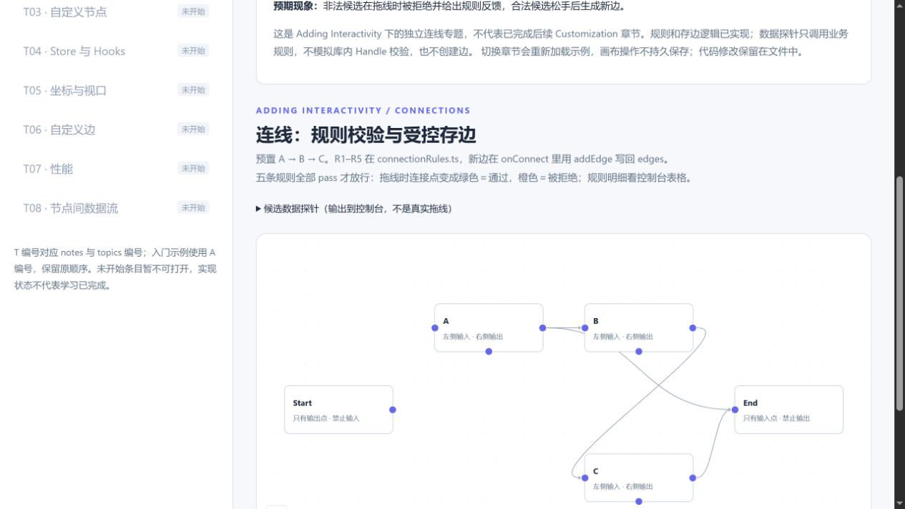

# 连线学习笔记

源码版本：`@xyflow/react@12.12.1`。地图：[SOURCE_MAP.md](../SOURCE_MAP.md)。
官方阅读：[Handling connections](https://reactflow.dev/learn/concepts/adding-interactivity#handling-connections)、[Handles](https://reactflow.dev/learn/customization/handles)。
练习：[ConnectionExercise.tsx](../reactflow-demo/src/topics/02-connection/ConnectionExercise.tsx)、[connectionRules.ts](../reactflow-demo/src/topics/02-connection/connectionRules.ts)。

## 记录约定

- **源码事实**：已在固定版本文件中读到的调用、分支或类型，不等于浏览器实测。
- **推断**：没有实测支撑的因果解释或预期行为；下文相关说明均保留此标记。
- **实测**：需要写清操作、初始图、日志与画布现象后才能标记，不能把 lint/build 通过当作拖线实测。
- 预测写在实现之前，实测结果一律回填到「逐场景预测 vs 实际」表；没有实测支撑的解释继续标“推断”，不把预测改写成实际。

## 建议阅读顺序

路径以 `reactflow-study/` 为起点，行号对应上述 tag。

| 顺序 | 源码位置 | 阅读时回答的问题 |
| --- | --- | --- |
| 1 | `xyflow/packages/react/src/components/Handle/index.tsx:88` · `HandleComponent`；重点看第 124 行 `onConnectExtended` 与第 152 行调用 | Handle 把哪些信息交给 XYHandle？受控模式中，onConnectExtended 自己写 edges 吗？ |
| 2 | `xyflow/packages/system/src/xyhandle/XYHandle.ts:26` · `onPointerDown`；继续读第 128 行 `onPointerMove`、第 201 行 `onPointerUp` | 移动时更新了什么？松手时满足哪些条件才调用 onConnect？ |
| 3 | `xyflow/packages/system/src/xyhandle/XYHandle.ts:252` · `isValidHandle` | 库内检查与业务 isValidConnection 谁先发生？从输入点开始反向拖线时，source/target 如何确定？ |
| 4 | `xyflow/packages/react/src/utils/edges.ts:13` · `addEdge` | React 层包装增加了什么？它将处理委托给了谁？ |
| 5 | `xyflow/packages/system/src/utils/edges/general.ts:139` · `addEdge`，回看第 105 行 `connectionExists` | 内置查重比较了哪些字段？它与“不区分 Handle 的同一节点对”规则是否一致？ |

## 核心机制（除标注“推断”外，均已用真实拖线验证）

1. 【实测】Handle 收到按下事件，把节点、端口和回调交给 `XYHandle.onPointerDown`（`Handle/index.tsx:124-152`）。
2. 【实测】移动超过阈值后进入连接状态，`onPointerMove` 每次移动都去找 `connectionRadius`（默认 20px）内最近的候选 Handle（`XYHandle.ts:128-199`）。
3. 【实测】`isValidHandle` 先把两端归一成 source / target，再判断端口可连接性与连接模式（Strict 模式下 source 只能连 target）；指针正压在一个 Handle 上时以 `handleBelow` 优先于“最近 Handle”（`XYHandle.ts:252-321`）。
4. 【实测】库内检查与业务 `isValidConnection` 是 `&&` 短路关系：库内不成立那一步就**不会**调用业务回调；成立才调，布尔结果写进连接状态的 `isValid`。
5. 【实测】因此“没有任何规则日志”只能说明那一步没过库内检查，不能说明业务规则没写：指针停在空白处时业务回调 0 次；而拖向某个 source Handle 的路上，`handleBelow` 之前的移动已经把“最近的对向 Handle”当候选，业务回调照样被调用过。
6. 【实测】`onPointerMove` 更新临时连接状态（含 `isValid` 与候选端口）；一次拖线里 `isValidConnection` 被调用 **1–4 次**（本练习 12 个场景的实测区间），不是每个 `mousemove` 一次。
7. 【实测】`onPointerUp` 只有在「有候选 + `isValid` 为 true」时才调 `onConnect`，之后**无条件**调用 `onConnectEnd`——松在空白处也会调。
8. 【实测】React 层 `onConnectExtended` 先把 `defaultEdgeOptions` 合进参数，再转给画布的 `onConnect`；只有 `defaultEdges`（非受控）分支才自动加边，受控时加不加边完全取决于你自己的 `onConnect`。
9. 【源码，未单独实测】受控 edges 下 `onConnect` 只通知、不写库：要写 `setEdges((eds) => addEdge(connection, eds))` 才留下新边（这条没做“注释掉写回”的对照实验，理由是结构上 `triggerEdgeChanges` 只调 `onEdgesChange`）。
10. 【源码事实；合法存边和 null 规范化另有实测】system `addEdge` 会拒绝缺少 source/target 的输入、为 Connection 补 id、用 `connectionExists` 查重、删除值为 `null` 的 Handle 字段后返回新数组；它不改 state，也不懂业务规则。查重比较两端节点及 Handle（缺失值与 null 按无标识端口处理）。

## 练习范围与反馈入口

- 事实：Start 仅一个 source Handle；End 仅一个 target Handle；A/B/C 各一个输入与两个输出（`out-main` / `out-alt`）。
- 事实：初始只有 A→B、B→C 两条边；R1–R5 已填写（见 `connectionRules.ts`），C1/C2 的存边已在 `onConnect` 里用 `addEdge` 写回 edges。
- 事实：业务回调将五条规则结果输出为控制台表格；全部 pass 才返回 true，任一 fail 就拒绝该候选。
- 事实：拖线期间 Start/End 显示端口结构提示；连接点颜色由连接状态的 CSS 类决定，绿色表示整体通过，橙色表示被规则拒绝。
- 【实测】Start/End 缺少非法方向的端口：拖线过程中 DOM 里查不到 `[data-nodeid="start"][data-handleid="in"]` 与 `[data-nodeid="end"][data-handleid="out-main"]`，画布上只多出两个结构提示（start「此处没有输入 Handle」、end「此处没有输出 Handle」）。所以「End→A」「A→Start」这类**结构上不存在的方向**没法用真实拖线触发，只能靠仅调用规则的合成数据探针覆盖。
- 【实测】方向与按下顺序无关：从 End 的输入点（target）反向拖到 B 底部的输出点（source），`onConnect` 收到的是 `source: 'b'`、`target: 'end'`，`onConnectEnd` 里的 `from` 反而是 `end/in`。语义方向由 Handle 类型决定，按下端不是 `source`。
- 规则约定：“同一对节点”按有向 source→target 判断，忽略 Handle；反向候选同时需要接受判环检查。
- 边界：不实现持久化、撤销或执行引擎；切换章节或刷新重新创建示例。探针不经过库内 Handle 校验、不写入边数组。
- 动手顺序：R1/R2 → R3 → R5 → R4 → C1/C2；算法与存边语句已填写完成，规则实现见 `connectionRules.ts`，存边见 `ConnectionExercise.tsx` 的 `onConnect`。

## 我读了哪些文件

- [x] `xyflow/packages/react/src/components/Handle/index.tsx`（`HandleComponent`、`onConnectExtended`，第 88-160 行）
- [x] `xyflow/packages/system/src/xyhandle/XYHandle.ts`（`onPointerDown` / `onPointerMove` / `isValidHandle` / `onPointerUp`，第 26-340 行）
- [x] `xyflow/packages/react/src/utils/edges.ts`（`addEdge` 的 React 层包装）
- [x] `xyflow/packages/system/src/utils/edges/general.ts`（`addEdge`、`connectionExists`）

## 骨架检查记录（不是规则验收）

2026-11-05：lint 与 build（含 TypeScript）通过。浏览器中已打开连线专题，观察到 Start、A、B、C、End 与两条预置边；点击 End→A 探针出现候选和规则表格日志；实际拖动 Start 输出到 A 输入，出现开始、业务校验、结束日志，边数仍为 2，未出现 onConnect 日志。这些观察只覆盖未填写 TODO 的骨架，不能证明方向、自连、判环和查重算法正确；合法存边流程也未实测。

2026-11-05（补）：TODO 填完后的完整实测见下面「预测 vs 实际」，本节只是留档骨架阶段看到的现象，结论以实测表为准。

## 预测 vs 实际

### 两条关键预测（写在实现之前，2026-11-05）

依据：官方 [Handles](https://reactflow.dev/learn/customization/handles) 与 [Adding Interactivity](https://reactflow.dev/learn/concepts/adding-interactivity) 只说明了「从 Handle 拖到 Handle 会触发 onConnect」，没写校验回调的次数和时机；下面两条把源码阅读（`XYHandle.ts:128-199`、`252-321`）与猜测分开记，实测结果填在后文表格里。

**预测 A · `isValidConnection` 的调用时机和次数**

1. **时机**：只在**指针移动**且「落在某个 Handle 上或进入 `connectionRadius` 范围内」时被调用；`pointerup` 不再问一次，而是直接用最后一次移动算出的 `isValid` / `connection` 决定要不要调 `onConnect`。
2. **次数**：一次完整拖线会被调用**多次**——每个命中候选 Handle 的 `mousemove` 各一次，同一候选被反复命中就反复调用。本练习的日志按「候选 + 规则结果」去重，所以控制台只出现一张表格，**不能拿表格数量反推回调次数**（准备用计数器验证）。
3. **命中不了就没有**：指针停在空白处或离所有 Handle 都很远时，`isValidHandle` 里的 `handleToCheck` 为空，业务回调一次都不会被调用。
4. **库内检查在前且短路**：`connectable && connectableend` 与 Strict 模式的「source 只能连 target」先判断，不成立时业务回调不会被调用（`XYHandle.ts:307-315` 的 `&&` 短路）。所以「从 A 的输出点拖到 B 的输出点」预计**没有任何**规则日志。

**预测 B · `onConnect` 的参数字段**

1. 只有一个参数，字段就是 `Connection` 的四个：`source`、`target`、`sourceHandle`、`targetHandle`，类型都是 `string | null`；**没有** event、坐标、节点对象或边 id（id 由 `addEdge` 的 `getEdgeId` 生成）。
2. Handle id 来自我们自己写的 `<Handle id="out-main" />` 等，所以正常拖线应看到 `{ source: 'start', target: 'a', sourceHandle: 'out-main', targetHandle: 'in' }`。
3. **方向与按下顺序无关**：从输入点（target）反向拖时，`isValidHandle` 用 `isTarget` 把两端对调（`XYHandle.ts:298-303`），语义方向仍是 source → target。预测从 End 的输入点拖到 C 的输出点，`onConnect` 收到的是 `source: 'c', target: 'end'`。
4. 一次拖线**最多调用一次**，且前提是「松手时命中的候选存在 + `isValid` 为 true」。

### 实测环境与方法

2026-11-05，`pnpm dev`（Vite，React 19 + `StrictMode`，`@xyflow/react@12.12.1`）+ Chrome DevTools Protocol 驱动**真实鼠标事件**：先把画布 `scrollIntoView`（否则 Handle 在视口外、坐标打不中），再 `mouseMoved → mousePressed → 10~12 次 mouseMoved → mouseReleased`，每步间隔 30ms。证据来源三处：① 控制台的分组表格日志（每组包含规则名与结果）；② 脚本钩住的 `window.__logs` 原始参数（含 `onConnect` 参数、`onConnectEnd` 的 `isValid` / `from` / `to`）；③ 业务代码里 `validationCalls` 计数器（`isValidConnection` 的实际调用次数，日志表格按“候选 + 结果”去重，不能用表格数量反推次数）。边数用 `.react-flow__edge` 的 `data-id` 列表统计。每个场景开始前刷新页面回到初始图（2 条边 `a-b`、`b-c`），除非特意构造脏图。

### 两条关键预测的结论

**预测 A · `isValidConnection` 的调用时机和次数**

| 预测 | 实测 | 结论 |
| --- | --- | --- |
| 只在指针移动且命中 Handle / 进入 `connectionRadius` 时调用，`pointerup` 不再问一次 | 所有场景的 `validationCalls` 都是 0/1/2/4 这类小数字，且松手后不再增加 | ✅ 成立 |
| 一次拖线会被调用多次 | 12 个场景实测区间 **0–4 次**（`start→a` 2 次；`a→b` 同端口重复 4 次；`a→b` 换端口 2 次；`c→a` 1 次） | ✅ 方向对，但数量比“每个 mousemove 一次”少得多：只有指针进入半径或命中 Handle 的那些移动才算 |
| 指针停在空白处时一次都不会被调用 | 拖到空白松手：`validationCalls: 0`，无规则表格，`onConnectEnd` 的 `to: null`、`isValid: null` | ✅ 成立 |
| 从 A 输出拖到 B 输出**没有任何**规则日志 | 最后一步指针压在 `b/out-main` 上时确实没调；但**前面的移动已经用候选 `b/in` 调了 2 次**（`a → b`，R5 拒绝），最后一步才是库内短路 | ⚠️ 部分错：短路成立，但“全程无日志”只在指针全程压在 source Handle 上时才对 |
| （隐含）表格数量 = 调用次数 | 一次拖线只打印**一张**表，计数器却是 2 / 4 | ❌ 不成立，去重的是日志不是回调 |

**预测 B · `onConnect` 的参数字段**

| 预测 | 实测 | 结论 |
| --- | --- | --- |
| 只有 `source` / `target` / `sourceHandle` / `targetHandle` 四个字段，没有 event、坐标、节点对象、边 id | 实测参数里除了这四个，还多了 `markerEnd: { type: 'arrowclosed' }`——来自 `Handle/index.tsx:124-138` 把 `defaultEdgeOptions` 合进参数（本练习用了 `defaultEdgeOptions` 画箭头）；event / 坐标 / 节点对象 / id 确实都没有 | ❌ 部分错：字段被 `defaultEdgeOptions` 扩展了 |
| 正常拖线看到 `{ source: 'start', target: 'a', sourceHandle: 'out-main', targetHandle: 'in' }` | 完全一致，边 id 是 `addEdge` 生成的 `xy-edge__startout-main-ain` | ✅ 成立 |
| 方向与按下顺序无关，反向拖仍归一到 source → target | 从 `end/in` 拖到 `b/out-alt`：`onConnect` 收到 `{ source: 'b', sourceHandle: 'out-alt', target: 'end', targetHandle: 'in' }`，而 `onConnectEnd` 的 `from` 是 `end/in`（按下端）、`to` 是 `b/out-alt` | ✅ 成立，且说明 `from`/`to` 与语义方向是两回事 |
| 一次拖线最多一次 `onConnect`，且要求「有候选 + `isValid`」 | 每次成功拖线只出现 1 条 `[连线 / onConnect]`；空白处松手、被规则拒绝时都没有 | ✅ 成立 |

### 逐场景预测 vs 实际

| 场景与操作 | 预测（推断） | 实际 | 日志 / 证据 | 吻合？ |
| --- | --- | --- | --- | --- |
| Start 输出 → A 输入 | 合法；出现 onConnect，边数 +1 | 5 条规则全通过；边 2 → 3，新增 `xy-edge__startout-main-ain`；`onConnect` = `{markerEnd, source:'start', sourceHandle:'out-main', target:'a', targetHandle:'in'}` | 一张规则表（5 项通过）；`validationCalls: 2` | ✅ |
| C 输出 → End 输入 | 合法；出现 onConnect，边数 +1 | 5 条规则全通过；边 2 → 3，新增 `xy-edge__cout-main-endin`；`onConnectEnd.isValid: true` | 规则表 5 项通过；`validationCalls: 2` | ✅ |
| 拖线时观察 Start 的输入侧、End 的输出侧 | 没有对应端口；可能未进入业务校验，观察结构提示 | DOM 里 `start` 无 `in` Handle、`end` 无 `out-main` Handle；拖线中画布多出两个提示：start「结构提示：此处没有输入 Handle」、end「结构提示：此处没有输出 Handle」；松在空白处 → 无规则回调 | `document.querySelector` 两者均 `false`；提示 span 文本如上 | ✅（并把“可能未进入校验”收紧为“根本没有 Handle 可命中”） |
| 数据探针 End→A（非真实拖线） | R1 拒绝；不建边 | R1 拒绝，R2–R5 通过；边数不变 | 探针表格：R1「拒绝」；无 onConnect | ✅ |
| 数据探针 A→Start（非真实拖线，**前置：先拖一次 Start→A 得到 `start→a`，使图上存在该边**） | R2 拒绝；不建边 | R2 拒绝，**R4 也拒绝**（图上已有 `start→a`，`a→start` 会成环），R1/R3/R5 通过 | 探针表格两行拒绝 | ✅＋补充：多条规则可同时拒绝；若在初始图 `a-b`、`b-c` 上直接跑，从 start 出发无边可走，R4 会**通过**，只有 R2 拒绝 |
| A 输出 → A 输入 | R3 拒绝；不产生新边 | R3 拒绝，R1/R2/R4/R5 通过；边数不变、无 onConnect | `validationCalls: 2` | ✅ |
| 初始 A→B→C 上，C 输出 → A 输入 | R4 拒绝；不产生新边 | R4 拒绝（从 `a` 可达 `{b, c}`，`c` 在集合里）；其余通过 | `validationCalls: 1` | ✅ |
| A 右侧输出 → B 输入（同端口重复） | R5 拒绝；松手前就有反馈 | R5 拒绝（`a/out-main → b/in` 已存在）；连线过程一直是橙色，松手不建边 | `validationCalls: 4`（同一候选被反复命中，次数最多） | ✅ |
| A 底部输出 → B 输入（换端口重复） | R5 仍应拒绝；不能只依赖 addEdge 的查重 | R5 拒绝；`addEdge` 的内置 `connectionExists` 比较两个 Handle，这种“同节点对、不同端口”它**不会**拦 | `validationCalls: 2` | ✅ |
| 删除 B→C 后，重试 C→A | R4 允许此候选；验证判断使用当前图 | 先点中边 `b-c`（`onEdgesChange: select`）按 Delete，边 3 → 2；再拖 `c/out-main → a/in`：5 条全通过，边 2 → 3，新增 `xy-edge__cout-main-ain` | 删除前后 `data-id` 列表；删后 `validationCalls: 1` | ✅ 规则读的是最新 edges，不是挂载快照 |
| 合法增加 Start→A 后立即重连 | R5 拒绝；验证判断使用最新边状态 | 第二次拖 `start/out-main → a/in`：R5 拒绝、其余通过，边数 3 → 3，无 onConnect | `onConnectEnd.isValid: false` | ✅ |
| 从 End 输入反向拖到 C 输出 | 观察语义方向是否为 C→End | 实测拖到 B 底部输出（同一实验里更近的 source Handle）：`onConnect` = `{source:'b', sourceHandle:'out-alt', target:'end', targetHandle:'in'}`，边 3 → 4 `xy-edge__bout-alt-endin`；`onConnectEnd.from = end/in`、`to = b/out-alt` | `validationCalls: 2` | ✅ 方向由 Handle 类型归一 |
| 在空白处松手 | 不生成边；记录结束回调和业务校验是否出现 | 不生成边；`[连线 / 开始]` 与 `[连线 / 结束]` **仍成对出现**，`to: null`、`isValid: null`、`validationCalls: 0`，并有一条 info 提示“本次没有进入业务规则回调” | 空白落点日志 | ✅（补充：`onConnectEnd` 不能当“成功”信号） |

额外补测（原表没有）：

| 场景与操作 | 预测 | 实际 | 证据 |
| --- | --- | --- | --- |
| A 输出 → B 输出（source → source） | 库内短路，应该没有任何规则日志 | 最后一步压在 `b/out-main` 时库内短路、没为它调用业务回调；但前 9 步的候选是“最近的对向 Handle `b/in`”，业务回调被调用 2 次（`a → b/in`，R5 拒绝）。`onConnectEnd.isValid: false`、`to = b/out-main`，边数不变 | `validationCalls: 2`；规则表只有 `a → b` 一张 |
| 反向拖是否受 R5 影响 | 未预测 | `b/out-alt → end/in` 与已有 `b/out-main → c` 节点对不同，R5 通过 | 同上 |

## 我的理解

1. **一次拖线的完整链路**（源码顺序 + 实测对得上）：`Handle` 的 `onPointerDown` 只做登记 → `XYHandle.onPointerDown` 记下起点 → 移动超过阈值后 `onPointerMove` 用 `getClosestHandle(connectionRadius)` 找候选 → `isValidHandle` 归一方向并跑「库内检查 → 业务 `isValidConnection`」→ 结果写进连接状态 → `onPointerUp` 在「有候选 + `isValid`」时才 `onConnect`，之后无论成败都 `onConnectEnd`。
2. **受控模式的“最后一公里”在自己手里**：库只通知，不替你改数据。`onConnect` 里用函数式更新 `setEdges((eds) => addEdge(connection, eds))`，updater 拿到的是更新队列里的前一步结果，所以能基于**最新** edges 判重。真正会漏判的是**漏写依赖**：`useCallback((c) => setEdges(addEdge(c, edges)), [])` 把 `edges` 锁死在回调创建那次的渲染上，连续拖线时就基于旧快照判重；只要把 `edges` 写进依赖数组，两次拖线之间 React 重渲染会给你新回调，就不会漏判。函数式更新的好处不是“修掉漏判”，而是依赖数组可以只写 `[setEdges]`，不需要手动维护 `edges` 依赖。
3. **`addEdge` 只做三件事**：补 id（`xy-edge__` + `source` + `sourceHandle` + `-` + `target` + `targetHandle`）、用 `connectionExists` 比较四个字段查重、返回新数组。它既不写 state，也不懂业务规则。id 里带 Handle，直接解释了“同节点对、换端口”为什么会被内置查重放过。
4. **业务规则的粗细由自己定**：R5 要的是「有向节点对唯一」，比 `connectionExists` 的「四字段完全相同」更粗，所以必须在 `isValidConnection` 里自己判，不能指望 `addEdge` 兜底。
5. **判环从 target 沿出边搜索**：加 `s → t` 会成环 ⇔ `t` 已经能到达 `s`。当前实现用 `stack.pop()` 做迭代式 DFS，收集可达节点后判断是否包含 `s`；不是 BFS，也不是沿入边走。删掉 `b-c` 后 `c → a` 立刻放行，说明规则用的是每次渲染最新的 `edges`（`inspectConnection` 的依赖数组里有两份状态），不是挂载时的快照。
6. **`isValidConnection` 是“预览级”的检查**：移动过程中会反复校验候选（已有实测 0–4 次/拖线），规则应保持纯函数、不 setState、不发请求。当前 DFS 每访问一个节点都扫描全部 edges，最坏 O(V×E)，不能写成 O(V+E) 或笼统称为“很便宜”；大图方案见补答 Q3。
7. **两层校验要分开看**：库内那层管结构性合法（方向、`connectable`、Strict 模式），业务这层管领域规则。所以“控制台没有规则日志”可能是“没命中 Handle”，也可能是“库内先否了”，不能直接当成“我的规则没跑”。
8. **`onConnect` 参数不是纯净四字段**：`Handle/index.tsx:124-138` 会把 `defaultEdgeOptions` 合进去（本练习因此多了 `markerEnd`）。好处是样式统一，坑是别假设参数形状固定——要断言字段就只断言自己关心的那几个。
9. **`onConnectEnd` 不是“成功”信号**：松在空白处也会触发，`to` 为 `null`、`isValid` 为 `null`（初值，不是 `false`）。判断成功只能看「有没有 `onConnect`」+「边 id 列表有没有变」。
10. **结构上缺失的端口是设计，不是 bug**：Start 没有 input Handle、End 没有 output Handle，所以 `End→A`、`A→Start` 这类非法方向在 UI 上根本拖不出来，规则只能靠合成数据探针验证。探针只调规则函数，不经过 XYHandle、也不写边——它是“单测”，不是“集成”。
11. **自动化验证连线的可靠信号**：拖线前 `scrollIntoView`，用 `getBoundingClientRect` 取 Handle 中心，节奏固定（10~12 步 × 30ms）；“调用了几次”必须靠代码里的计数器，日志表格是去重后的产物。

## 最初的问题（补答）

### 1. `sourceHandle` / `targetHandle` 什么时候是 `null`，和条件分支节点的多个出口是什么关系

**源码事实**：`Connection` 的两个 Handle 字段是 `string | null`。不写 `<Handle id>` 时，拖线产生的字段为 `null`；它不表示“多个出口非法”。`xyflow/packages/system/src/utils/edges/positions.ts:127-133` 的 `getHandle` 使用 `!handleId ? bounds[0] : bounds.find(...)`：不提供 id 时取该方向的**第一个 Handle**，多个 Handle 也不会因此自动报错。这里的“第一个”由测量后的 bounds 顺序决定，不是用户业务上的默认分支。没有该方向的 Handle，或显式指定了找不到的 id，才是另一类端点无法解析的问题。

Start 的实际输出 id 为 `out-main`，End 的实际输入 id 为 `in`，都不会因为“单端口”而自动变成 null。`End→A` / `A→Start` 探针中的 null 是人为构造的缺失方向数据；它们只测试规则，不能用来证明真实 Handle 的行为。

**Schema 决策建议**：条件分支的“是／否”必须使用不同且稳定的 id，例如 `yes` / `no`，并让边显式引用它们。这是业务语义约束，不是库会强制执行的约束。否则两个出口都可产生 null，边可以正常渲染，却无法表达究竟是哪条分支；同一下游的两条无 id 边还可能被 `addEdge` 判重折叠。当前 R5 更严格，直接按节点对拒绝第二条，不能照搬到允许分支汇合的产品。

我建议持久化 Schema 也要求**单出口**使用固定 id，本项目可沿用 `out-main`，输入沿用 `in`，无需另造命名。前后端按节点类型的端口定义校验，后端内部只处理规范化的字符串端口。兼容旧数据时，仅当该方向确有唯一出口，才可把 null／字段缺失迁移为固定值；多出口不能猜测。没有输出的 End 不应伪造出口。`addEdge` 会删除值为 null 的 Handle 字段，因此导入边界还要处理 undefined／缺失字段；规范化不能只检查 null。本轮只讨论设计，未新增后端或修改现有 Schema。

#### 去掉 task 两个 source Handle id：先预测，后实测（2026-11-06）

初始图为 A→B→C，安装包与源码 tag 均为 `@xyflow/react@12.12.1`。临时将右侧 source 的 id 改为 `data.role === 'task' ? undefined : 'out-main'`，移除底部 source 的 id；Start 保留原 id。预置两条边的旧 `sourceHandle: 'out-main'` 临时改成 null，以隔离“引用已不存在的旧 id”错误。回调和 setter 临时用 `JSON.stringify` 记录参数及存边结果，刷新后再操作。

| 操作 | 操作前预测 | 实测结果 |
| --- | --- | --- |
| A 底部出口 → End 输入 | 回调 sourceHandle 为 null；永久边取第一个 source，即 A 右侧，不会记住底部出口 | `onConnect` 为 `{source:'a', sourceHandle:null, target:'end', targetHandle:'in'}`（另有 markerEnd）；边数 2→3。SVG 路径从 `M385,35.75` 起，即 A 右侧出口，未从底部起 |
| C 右侧出口 → End 输入（接着上一步） | 同样得到 null，永久边从 C 右侧起 | `onConnect.sourceHandle` 为 null；边数 3→4，路径从 `M605,255.75` 起，即 C 右侧出口 |

两次 setter 日志中的新边均**没有 sourceHandle 字段**，与 `addEdge` 删除 null 字段的源码一致。两次正式拖线期间没有新增 warn/error；改代码的 HMR 阶段出现过 nodeTypes 更新警告，与 null 端口解析不是同一问题。预测得到验证：**渲染可成功，分支身份却丢失**。实验后已恢复两个出口 id、预置边和日志，不保留破坏性实验配置。

### 2. 五条规则各需要什么信息

| 规则 | 读 `connection` 的哪些字段 | 是否读 `nodes` | 是否读 `edges` | 依据 |
| --- | --- | --- | --- | --- |
| R1 · End 禁止输出 | `source` | 是（查 `source` 节点的 `role`） | 否 | `connectionRules.ts` `checkEndOutgoing` |
| R2 · Start 禁止输入 | `target` | 是（查 `target` 节点的 `role`） | 否 | `checkStartIncoming` |
| R3 · 禁止自连 | `source`、`target` | 否 | 否 | `checkSelfConnection` |
| R4 · 禁止有向环 | `source`、`target` | 否 | 是（从 `target` 可达性搜索） | `checkCycle` |
| R5 · 禁止重复节点对 | `source`、`target` | 否 | 是（看现有边是否已存在该节点对） | `checkDuplicatePair` |

归纳：**只看 connection 的是 R3**；**要读 nodes 的是 R1、R2**（查节点角色）；**要读 edges 的是 R4、R5**（拓扑可达性 / 重复边）。不需要节点坐标或边的几何，规则是纯函数，可被探针直接调用；但“纯函数”不等于“低成本”，R4 的扫描成本须单独考虑。

### 3. 前端校验和后端编译校验的职责边界

**本仓库范围**：这是前端学习 demo，没有工作流后端或编译器。R1–R5 是练习的产品约定，不能从它们推导出 LangGraph 或 Dify 的全部引擎限制。

**禁止成环的来源要先确定**：LangGraph 的 `StateGraph` 支持循环，条件边可以回到先前节点；需要设计退出条件并限制执行步数。因此如果未来接 LangGraph，R4 禁环是我们的产品策略，后端也应按该策略校验，而不是声称“引擎不支持环”。如果产品允许 Agent 循环，前端就不能无条件套用 R4；后端必须执行预算、步数、超时等运行约束。依据：[LangGraph 官方控制流说明](https://docs.langchain.com/oss/python/langgraph/use-graph-api)。

如果所选工作流编译器要求某一层图是 DAG，禁任意回边就是该层的编译约束：后端权威判定，前端同步约束以尽早反馈。这里要区分普通拓扑回边与显式 Loop 容器；Dify 已有 Loop 节点和终止条件／最大次数，不能概括成“Dify 完全不支持循环”。本仓库未绑定 Dify 版本或编译器，不能替它断言具体 DAG 边界。依据：[Dify 官方 Loop 文档](https://docs.dify.ai/en/cloud/use-dify/nodes/loop)。

| 校验类别 | 与 R1–R5 的关系 | 前后端职责 |
| --- | --- | --- |
| End 输出、Start 输入、自连、环、重复连接 | 对应 R1–R5；随产品／引擎能力确定具体规则 | 前端拖线即时反馈；后端接收、发布或执行前重新校验，防止导入、API 或其他客户端绕过 |
| 是否有 Start、入口数量、入口到出口可达性、孤立节点 | 全图完整性；R2 仅禁止“连入已存在的 Start”，不证明 Start 存在 | 前端可以预检；后端在编译／发布时必须完整检查。草稿可按产品规则允许暂缺配置，不能直接执行 |
| 节点存在、id 唯一、端口存在且方向匹配 | R1/R2 只查 role，查不到节点也可能 pass；不能替代 Schema 校验 | 前端导入时提示，后端拒绝悬空边和非法端口，不能依赖 React Flow 的命中检查 |
| 变量引用可否解析、字段路径、分支／循环作用域、输入输出类型 | 不属于 R1–R5；需要节点输出和执行语义 | 前端有元数据时可辅助检查，后端按实际节点注册表和编译环境解析，不能靠“连上了”证明引用有效 |
| 节点必填配置、表达式、模型／工具参数是否合法 | 不属于 R1–R5 | 前端表单校验，后端按实际节点版本、配置 Schema 再验；执行器还需处理运行时返回值 |
| 凭据是否有效、资源权限／租户边界、服务端节点版本、配额、实际执行结果 | 不属于 R1–R5，前端无法权威判断 | 后端校验并在运行时执行限制；前端只能展示后端返回的诊断，不能承诺静态编译证明运行一定成功 |

R5 也不是普遍引擎定律：“是／否”两出口若都允许连向同一下游，不能只用 `(source,target)` 判重。应按分支身份（本例可用两端 Handle 与节点 id）判重，并保证分支 id 唯一、可被后端解析。

**大图方案（设计，尚未实现或压测）**：当前 `collectReachableNodes` 每弹出一个节点就完整扫描 E 条边，最坏 O(V×E)。邻接表版本才可做到单次 O(V+E)，但高频重复执行依然昂贵。

1. 图的拓扑变化时构建出边／入边邻接表、节点 id→role 表和连接去重集合；节点仅移动坐标时不重建。给拓扑和角色／规则配置维护版本，增删边、重连、导入和相关角色变更都要失效缓存。
2. 正向拖线时 source 固定，可沿入边一次求它的祖先集合；候选 target 在其中就拒绝。反向拖线时 target 固定，可沿出边一次求它的后继集合；候选 source 在其中就拒绝。拖线期间图版本不变时，R4 成员查询为 O(1)；也可缓存“图版本＋候选端点”的校验结果。Handle 相关规则另须把端口纳入缓存键。
3. 若预计算仍超出交互预算，可交给 Worker，结果必须携带图版本，过期结果丢弃；等待期间显示校验中并暂不放行。`isValidConnection` 返回同步 boolean，不能直接返回 Promise，也不能仅把最终校验防抖掉。
4. 正式 `onConnect` 写入前按最新图复核，后端编译时再次验证；当前 demo 还没有这道额外复核，不能把设计写成已实现。性能验证应覆盖链、扇出和大规模图，记录校验耗时及拖线帧耗时，再决定是否需要 Worker／更复杂的增量算法。

## 遇到的问题

1. **拖线完全没反应**：脚本按坐标按下、移动、松手，控制台连 `[连线 / 开始]` 都没有。原因是画布在视口下方，Handle 中心坐标落在窗口外，CDP 的事件打到了别处。处理：拖之前先 `element.scrollIntoView({ block: 'center' })`，再用 `getBoundingClientRect()` 现取坐标。
2. **“只有一张表”让我误判校验次数**：本练习的日志按「候选 + 规则结果」去重，一次拖线只打一张表，看起来 `isValidConnection` 只跑了 1 次。加 `validationCalls` 计数器后才看到实际是 2 次、4 次。
3. **规则日志的 `targetHandle` 和视觉落点不一致**：把指针压在 `b/out-main`（source Handle）上时，之前的移动已经把“最近的对向 Handle `b/in`”当候选，于是日志写的是 `a → b/in`。`handleBelow`（指针正压在某个 Handle 上）优先，但“最近 Handle”在半径 20px 内也会当选，两者不能混为一谈。
4. **`onConnect` 参数比预测多一个字段**：多了 `markerEnd: { type: 'arrowclosed' }`，来自 `defaultEdgeOptions` 在 `Handle/index.tsx` 里被合并。我原来的“只有四个字段”的预测是错的。
5. **空白处松手时 `isValid` 是 `null` 而不是 `false`**：`onConnectEnd` 照常触发，一开始以为“结束了就说明连上了”。实际它的作用是“通知拖线结束”，成功与否得看 `onConnect`。
6. **探针会测出“假失败”**：探针只调用规则函数、不看图上线不线，所以图里已经有 `start→a` 时，用 `Start→A` 探针会得到 R5 拒绝——那不是规则错，是我的用例选错了。探针必须配干净图，或者明确把它当“重复检测”的证据。
7. **删边不只是按 Delete**：`deleteKeyCode` 只作用于选中元素。脚本里要先 `click` 那条边（用 `data-id` 定位，别用 index，因为边会被重排），确认 `selected` 后再发 Delete；否则什么都没发生，还以为 R4 变了。
8. **反向拖时 `onConnectEnd.from` 是 target 端**：看到 `from = end/in`、`to = b/out-alt` 的第一反应是“边方向反了”。其实 `from` / `to` 是“按下端 / 落点端”，`source` / `target` 是按 Handle 类型归一的语义方向。
9. **调用次数会随自动化节奏漂移**：同样的拖线，步数从 10 改到 12、间隔从 30ms 改到 50ms，`validationCalls` 就在 1–4 之间变。所以它只能用来验证“时机假设”（是否只在移动时调、松手不再调），不能写成固定数字断言。

